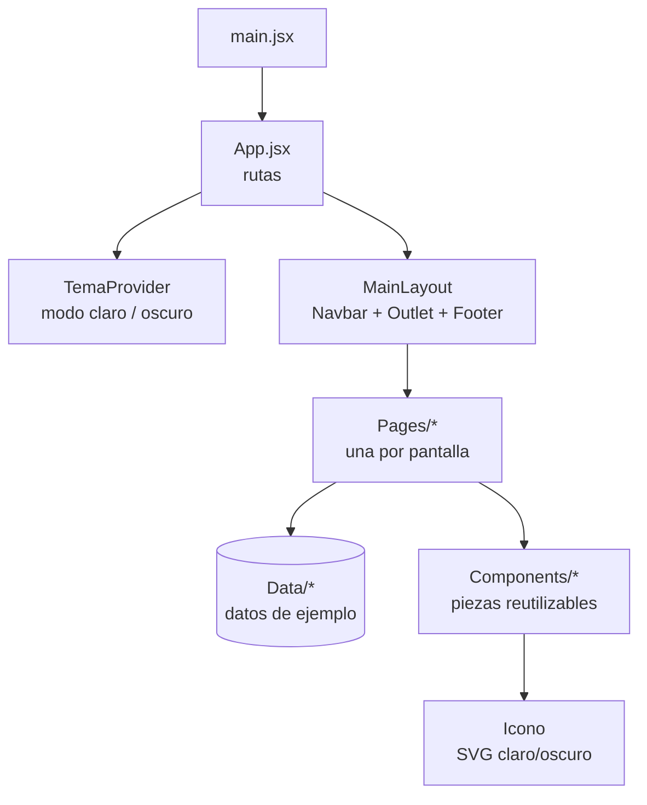

# Portal académico · Universidad Autónoma Los Búhos

> **Actividad 4.2 · Diseño de Interfaces · Unidad 4: Desarrollo y Tendencias del Diseño de UI**
> Convertir en código el diseño de Figma de la Actividad 3.2 (*Act_3_2_LópezMartínez_JoséEduardo_DeLaCruzMendoza_Israel*).

| | |
|---|---|
| **Equipo** | Natalia Ramírez Martínez · Jair Hernández García |
| **Diseño original** | [Figma](https://www.figma.com/design/hjklgkx6jUp8EksHnnO9RT) |
| **Qué es** | Portal del alumno: consulta su información académica, calificaciones, horario, cursos y tareas |
| **Estado** | 10 pantallas implementadas · modo claro/oscuro · móvil, tablet y escritorio · 20 pruebas |

---

## Contenido

1. [Cómo correr el proyecto](#cómo-correr-el-proyecto)
2. [Tecnologías](#tecnologías)
3. [Cumplimiento de la consigna](#cumplimiento-de-la-consigna)
4. [Pantallas](#pantallas)
5. [Arquitectura](#arquitectura)
6. [Sistema de diseño](#sistema-de-diseño)
7. [Componentes](#componentes)
8. [Cómo se integran en el layout](#cómo-se-integran-en-el-layout)
9. [Pruebas](#pruebas)
10. [Diseño responsivo](#diseño-responsivo)
11. [Limitaciones y trabajo futuro](#limitaciones-y-trabajo-futuro)
12. [Flujo de trabajo](#flujo-de-trabajo)

---

## Cómo correr el proyecto

Requisitos: **Node.js 20 o superior** y npm.

```bash
npm install        # instala dependencias
npm run dev        # abre el portal en http://localhost:5173
npm test           # corre las pruebas una vez
npm run test:watch # corre las pruebas cada vez que guardas un archivo
npm run lint       # revisa el código con Oxlint
npm run build      # genera la versión de producción en dist/
npm run preview    # sirve la versión de producción para revisarla
```

---

## Tecnologías

| Herramienta | Versión | Para qué |
|---|---|---|
| [React](https://react.dev) | 19 | Componentes de la interfaz |
| [Vite](https://vite.dev) | 8 | Servidor de desarrollo y compilación |
| [Tailwind CSS](https://tailwindcss.com) | 4 | Estilos, con la paleta y las fuentes del Figma como tema |
| [React Router](https://reactrouter.com) | 7 | Navegación entre páginas |
| [Vitest](https://vitest.dev) + [Testing Library](https://testing-library.com) | 5 / 16 | Pruebas de componentes |
| [Oxlint](https://oxc.rs) | 1 | Revisión de código |

### Sobre el uso de React en lugar de Vue.js

La consigna sugiere Vue.js y Web Components. Elegimos **React** porque <!-- TODO equipo: escribir el motivo real
(p. ej. experiencia previa del equipo, autorización del profesor, etc.) -->. Los principios que pide la
actividad se cumplen de la misma forma:

| Lo que pide la consigna | Cómo lo resolvemos en React |
|---|---|
| Componente modular y reutilizable | Un componente por archivo en `src/Components`, sin depender de una página concreta |
| Encapsulación de estilo | Las clases de Tailwind viven dentro del propio componente; no hay CSS global por componente |
| Encapsulación de lógica | Cada componente maneja su propio estado (`useState`) y efectos (`useEffect`, `useClicFuera`) |
| Manejo de **props** | Los datos entran por props (documentadas con JSDoc) |
| Manejo de **eventos** | Los componentes avisan al padre con funciones `on…` (`onCambiar`, `onEntregar`, `onSeleccionar`, `onVerTodo`) |
| Pruebas con Jest / Vue Test Utils | Vitest (API compatible con Jest) + React Testing Library |

---

## Cumplimiento de la consigna

| # | Requisito | Dónde se ve |
|---|---|---|
| 2 | Diseño y hand-off de Figma listos para código | Cada componente indica en su JSDoc el frame de Figma que reproduce |
| 3 | Entorno de desarrollo configurado | `package.json`, `vite.config.js` |
| 4 | Componentes modulares, con props y eventos | [`src/Components`](src/Components) · [Componentes](#componentes) |
| 5 | Documentación de cada componente | JSDoc en cada archivo + este README |
| 5 | Pruebas unitarias | [`src/test`](src/test) · [Pruebas](#pruebas) |
| 5 / 6 | Responsivo (desktop, tablet y móvil) | [Diseño responsivo](#diseño-responsivo) |
| 6 | Layouts construidos con los componentes | [`src/Layout/MainLayout.jsx`](src/Layout/MainLayout.jsx) y [`src/Pages`](src/Pages) |
| 6 | Fácil de navegar | Menú principal, pestañas académicas, flechas de regreso y menú móvil |
| 6 | Consistente con el sistema de diseño | Paleta y tipografías del Figma como tema de Tailwind |
| 7 | Repositorio `Act_4_2_Apellidos_Nombres` con colaborador `vsilvardz` | Este repositorio |

---

## Pantallas

| Ruta | Página | Frame de Figma | Qué se puede hacer |
|---|---|---|---|
| `/` | Inicio | Home | Ver galería, imagen destacada y carrusel de noticias |
| `/login` | Inicio de sesión | Login | Elegir semestre, escribir clave y contraseña; valida los campos y entra |
| `/info-academica` | Información académica | Main info académica | Ver datos del alumno e ir a cada sección |
| `/calificaciones` | Calificaciones | Calificaciones | Consultar parciales y calificación final por materia |
| `/horario` | Horario | Horario | Consultar el horario semanal |
| `/cursos` | Cursos | Main Cursos | Ver la lista de cursos y entrar a uno |
| `/cursos/:id` | Curso | Curso | Ver el muro con tareas y anuncios del curso |
| `/cursos/:id/anuncios/:anuncioId` | Publicación | Publicación | Leer un anuncio completo |
| `/tareas` | Tareas | Main Tareas | Filtrar por Pendientes, Vencidas o Completadas (`?estado=`) |
| `/tareas/:id` | Tarea | Tarea | Ver instrucciones y materiales, y subir la entrega |

Todas las pantallas tienen **modo claro y oscuro**.

---

## Arquitectura



**Cómo fluye la información:**

1. `main.jsx` monta `<App />` en el `<div id="root">` de `index.html`.
2. `App.jsx` envuelve todo en `TemaProvider` y `BrowserRouter` y define qué página va en cada ruta.
3. `MainLayout` dibuja la barra superior y el pie, y en medio (`<Outlet />`) la página actual.
4. Cada **página** importa sus datos de `src/Data` y se los pasa a los **componentes** por props.
5. Los componentes solo muestran lo que reciben y avisan al padre con eventos (`on…`).

Gracias a esta separación, para conectar el portal a un servidor real basta con reemplazar
los archivos de `src/Data` por llamadas a una API. Los componentes no cambian.

```
src/
├── main.jsx        Punto de entrada
├── App.jsx         Rutas
├── index.css       Tema de Tailwind (colores y fuentes del Figma)
├── Components/     Componentes reutilizables (uno por archivo)
├── Pages/          Páginas: arman componentes y datos
├── Layout/         MainLayout: barra superior + contenido + pie de página
├── Context/        TemaContext: modo claro/oscuro
├── Hooks/          useClicFuera: cierra menús al hacer clic fuera o con Escape
├── Data/           Datos de ejemplo (alumno, cursos, tareas, horario…)
├── assets/icons/   Íconos exportados de Figma, en claro/ y oscuro/
└── test/           Pruebas con Vitest y Testing Library
```

---

## Sistema de diseño

La paleta y las fuentes del Figma están definidas como tema de Tailwind en [`src/index.css`](src/index.css),
así que se usan con clases como `bg-negro-fondo`, `text-gris-texto` o `font-mono`.

| Color | Valor | Clase |
|---|---|---|
| Negro Fondo | `#121212` | `negro-fondo` |
| Negro Primario | `#171717` | `negro-primario` |
| Blanco Primario | `#FFFFFF` | `blanco-primario` |
| Blanco Fondo | `#FAFAFA` | `blanco-fondo` |
| Gris Oscuro | `#333333` | `gris-oscuro` |
| Gris para Texto | `#9CA3AF` | `gris-texto` |
| Gris Primario | `#D1D5DB` | `gris-primario` |
| Gris Claro | `#E5E7EB` | `gris-claro` |
| Rojo Error | `#B91C1C` | `rojo-error` |
| Azul Enlace | `#1C77C3` | `azul-enlace` |

**Tipografía:** Roboto (textos) y Roboto Mono (logo y nombre del curso).

**Modo oscuro:** `TemaContext` agrega la clase `dark` a `<html>` y guarda la preferencia en
`localStorage`. Los estilos usan la variante `dark:` de Tailwind, por ejemplo
`bg-blanco-fondo dark:bg-negro-fondo`. Un pequeño script en `index.html` aplica el tema antes de
pintar la página para evitar un parpadeo.

**Íconos:** cada ícono se exportó del Figma en dos versiones (`assets/icons/claro` y `assets/icons/oscuro`).
El componente `Icono` dibuja ambas y CSS muestra la que corresponde al tema.

---

## Componentes

Cada componente está documentado con **JSDoc** en su archivo (propósito, props y comportamiento).
Resumen:

### Estructura y navegación

| Componente | Propósito | Props | Eventos |
|---|---|---|---|
| `Navbar` | Barra superior. Escritorio: logo con nombre y enlaces; tablet: solo ícono; móvil: menú hamburguesa. | `enlaces`, `notificaciones` | — |
| `MenuMovil` | Botón hamburguesa con menú desplegable. | `enlaces` | — |
| `PanelNotificaciones` | Campana con la lista de notificaciones (con scroll). | `notificaciones` | `onSeleccionar`, `onVerTodo` |
| `BotonTema` | Cambia entre modo claro y oscuro (luna/sol). | — (usa `TemaContext`) | — |
| `Footer` | Pie con accesos rápidos, redes y contacto. | `enlaces`, `contacto` | — |
| `RedesSociales` | Íconos de Facebook, Instagram y YouTube. | `facebook`, `instagram`, `youtube` | — |
| `PestanasAcademicas` | Pestañas Horario / Calificaciones / Cursos / Tareas; resalta la actual. | `secciones` | — |
| `EncabezadoCurso` | Barra con flecha de regreso y nombre del curso. | `nombre`, `rutaRegreso` | — |

### Contenido

| Componente | Propósito | Props | Eventos |
|---|---|---|---|
| `Icono` | Ícono de Figma en su versión clara u oscura según el tema. | `nombre`, `className`, `alt`, `respaldo` | — |
| `TarjetaAlumno` | Foto y datos del alumno. | `alumno`, `foto` | — |
| `BotonAcceso` | Botón grande con ícono hacia una sección. | `ruta`, `icono`, `etiqueta` | — |
| `TablaCalificaciones` | Parciales y calificación final por materia. | `materias`, `titulo`, `columnas` | — |
| `TablaHorario` | Horario semanal (horas × días). | `dias`, `horas`, `clases` | — |
| `TarjetaCurso` | Ficha de un curso con portada, nombre y profesor. | `ruta`, `nombre`, `profesor`, `portada` | — |
| `PublicacionTarea` / `PublicacionAnuncio` | Publicaciones del muro de un curso. | `titulo`, `fecha`, `ruta`, `texto`, `marcadores` | — |
| `FiltrosTareas` | Pestañas Pendientes / Vencidas / Completadas. | `filtros`, `activo` | `onCambiar` |
| `FichaTarea` | Tarea en la lista: fecha, título, curso y puntaje. | `ruta`, `fecha`, `dia`, `titulo`, `curso`, `puntos`, `total` | — |
| `DetalleTarea` | Instrucciones, materiales y botón para subir la tarea. | `titulo`, `cierre`, `descripcion`, `materiales`, `permiteEntrega` | `onEntregar` |
| `MarcadorImagen` | Recuadro gris con ícono de foto mientras no hay imagen. | `className`, `etiqueta` | — |
| `Carrusel` | Imágenes con desplazamiento y botones anterior/siguiente. | `imagenes`, `etiqueta` | — |

### Formularios

| Componente | Propósito | Props | Eventos |
|---|---|---|---|
| `CampoTexto` | Campo con etiqueta y mensaje de error. | `etiqueta`, `valor`, `error`, `placeholder` | `onCambiar` |
| `CampoContrasena` | Campo de contraseña con botón para mostrarla u ocultarla. | igual que `CampoTexto` | `onCambiar` |
| `SelectorOpciones` | Botón con lista desplegable de opciones. | `etiqueta`, `opciones`, `valor` | `onCambiar` |

### Ejemplo de uso

```jsx
import { useState } from 'react';
import { CampoTexto } from './Components/CampoTexto';

function Ejemplo() {
  const [clave, setClave] = useState('');
  return (
    <CampoTexto
      etiqueta="Clave única"
      valor={clave}
      onCambiar={setClave}            // evento: recibe el nuevo texto
      error={clave ? undefined : 'Campo obligatorio'}
    />
  );
}
```

---

## Cómo se integran en el layout

`MainLayout` envuelve todas las páginas con `Navbar` y `Footer`. Cada página combina componentes.
Por ejemplo, **Calificaciones**:

```jsx
<TarjetaAlumno alumno={alumno} />
<PestanasAcademicas secciones={seccionesAcademicas} />
<TablaCalificaciones materias={calificaciones} />
```

Y **Tareas**, donde un componente avisa a la página y la página actualiza la URL:

```jsx
<FiltrosTareas
  filtros={filtrosTareas}
  activo={estado}
  onCambiar={(id) => setParams({ estado: id })}   // /tareas?estado=vencida
/>
{lista.map((t) => <FichaTarea key={t.id} {...} />)}
```

---

## Pruebas

Las pruebas están en [`src/test`](src/test) y se corren con `npm test`. Prueban el comportamiento como
lo haría una persona: escribir, hacer clic y leer lo que aparece en pantalla.

| Archivo | Qué prueba |
|---|---|
| `formularios.test.jsx` | Campos de texto, mostrar/ocultar contraseña, errores y selector de opciones |
| `tablas.test.jsx` | Encabezados y filas de calificaciones, "—" cuando falta una calificación, celdas del horario |
| `navegacion.test.jsx` | Modo oscuro (y que se recuerde), menú móvil, panel de notificaciones, pestaña activa |
| `paginas.test.jsx` | Validación y envío del Login, filtros de Tareas (y desde la URL), subir tarea, muro del curso y curso inexistente |

`src/test/utils.jsx` incluye `renderConRouter`, que monta un componente con el tema y un router en memoria.

---

## Diseño responsivo

Se siguieron las tres vistas del Figma (660, 980 y 1280 px) con los prefijos de Tailwind:

| Dispositivo | Ancho | Prefijo | Ejemplo de cambio |
|---|---|---|---|
| Móvil | < 768 px | (ninguno) | Menú hamburguesa, pestañas de 30 px y texto de 14 px |
| Tablet | 768–1023 px | `md:` | Enlaces visibles, solo el ícono del logo |
| Escritorio | ≥ 1024 px | `lg:` | Logo con nombre, pestañas de 80 px y texto de 24 px |

Además de las pruebas automáticas, el diseño responsivo y el modo oscuro se revisaron manualmente en
el navegador a 390, 768, 980 y 1280 px.

---

## Limitaciones y trabajo futuro

- **Sin servidor:** los datos son de ejemplo (`src/Data`) y el inicio de sesión es simulado.
- **Secciones en construcción:** *Oferta Educativa*, *Universidad* e *Investigación* muestran una página temporal.
- **Notificaciones:** "Ver Todo", "Marcar como leídas" y "Configuración" todavía no tienen acción.
- **Anuncios:** por ahora todos los cursos muestran los mismos anuncios de ejemplo.
- **Entrega de tareas:** el archivo se selecciona y se muestra su nombre, pero no se envía a ningún lugar.

---

## Flujo de trabajo

Cada paquete de cambios se trabajó en su propia rama y se integró a `main` con un *merge*:

`pagina-calificaciones` → `pagina-horario` → `pagina-cursos` → `pagina-tareas` → `pagina-login-inicio` → `pruebas-y-documentacion`

<!-- TODO equipo: si quieren, agreguen aquí qué hizo cada integrante. -->
